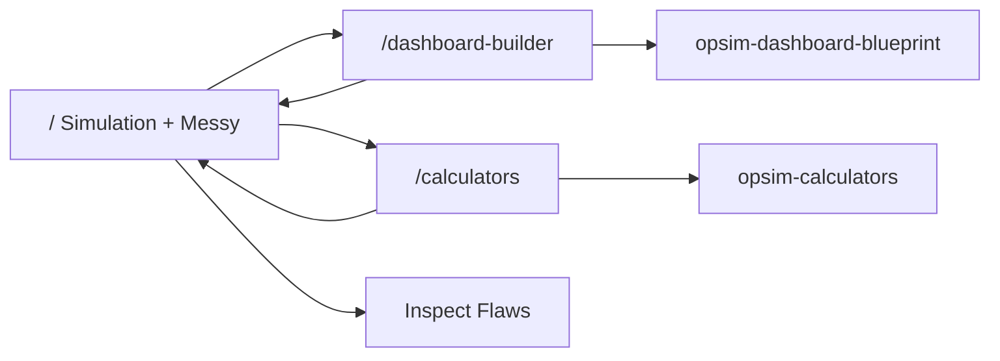

# OpsSim Day Modules: Messy Dashboard, Builder, and Calculator Suite

## Approach
Keep the live OpsSim engine on `/` as the training sandbox. Add two new client routes that share the same visual language and a **shared top command bar**:
- [`/dashboard-builder`](app/dashboard-builder/page.tsx): guided clean dashboard design
- [`/calculators`](app/calculators/page.tsx): interactive Governance and Operations Calculator Suite

Reuse weight math and print/export patterns across builder and calculators. Do not couple calculator state to the sim tick engine. Zero em dashes in all UI copy and comments.

---

## Shared navigation ([components/app-nav.tsx](components/app-nav.tsx))

Extract a compact command-bar fragment used on `/`, `/dashboard-builder`, and `/calculators`:
- Brand mark OpsSim
- Pill / link group: `Simulation` | `Dashboard Builder` | `Calculators` (active route highlighted in Dracula purple)
- Page-specific actions stay on the right (Present, Export, Inspect, etc.)

Wire into [`app/page.tsx`](app/page.tsx) masthead and both new pages via `next/link`.

---

## 1. Sample Messy Dashboard on home ([app/page.tsx](app/page.tsx))

**Header CTA:** `Build Clean Dashboard ->` links to `/dashboard-builder`. Nav also exposes Calculators.

**Messy metrics strip** beside / under real gauges:
- Vanity: Raw Tickets Closed 412, Emails Sent 1,280, Ad-Hoc Calls Logged 95
- Gaming: Fast Closure Rate 99% without visible counter; Inspect reveals Repeat / Reopen Rate 38%
- Clashing horizons: Today counts next to QTD Avg

**Inspect Flaws On/Off:** tags `Vanity Count`, `No Counter-Metric`, `Missing Formula`, `Lagging Only`, `Unowned Metric`, `Clashing Horizon`.

Files: [`components/messy-dashboard.tsx`](components/messy-dashboard.tsx) + CSS `.flaw-card` / `.flaw-tag` / `.inspect-on`.

---

## 2. Dashboard builder (`/dashboard-builder`)

Domain: [`lib/dashboard/`](lib/dashboard/) (`types`, `presets`, `weights`, `score`, `pdca`, `persistence` key `opsim-dashboard-blueprint`, `autocomplete`).

Hook: [`hooks/use-dashboard-builder.ts`](hooks/use-dashboard-builder.ts).

Steps 1-4 as previously specified (Audience, KPI face + matrices, Weightages + presets + role autocomplete, Walkthrough checklist + live preview + JSON/print export).

Components under `components/dashboard-builder/`.

Share `normalizeWeights` / score helpers with the calculator suite via [`lib/shared/weights.ts`](lib/shared/weights.ts) so both pages stay consistent.

---

## 3. Calculator Suite (`/calculators`)

Route: [`app/calculators/page.tsx`](app/calculators/page.tsx) (`"use client"`).

**Chrome:** Shared nav + top-right `Export All Calculations (JSON / Print Worksheet)`.

**Tab / pill switcher + All-in-One Summary:**
`Weightage` | `RACI` | `Scorecard` | `SLA Clock` | `Capacity` | `Power-Interest` | `Summary`

State: [`hooks/use-calculators.ts`](hooks/use-calculators.ts) + [`lib/calculators/`](lib/calculators/) with single persistence blob `opsim-calculators` (autosave after hydrate; import/export whole suite).

### 3.1 KPI and Sub-Matrix Weightage Calculator (Day 4)
- Unlimited KPI CRUD with overall KPI Weight %
- Nested sub-metric CRUD: Matrix Weight %, Actual Score, Target Score
- Live KPI weighted scores + **Overall Composite Governance Index (0-100%)**
- Total Weight badge (emerald at 100%, amber/rose otherwise), `Auto-Normalize to 100%`
- Presets: `Balanced Ops`, `Space & Manpower Focus`, `Vendor & SLA Governance`, `HSE & Compliance First`
- Anti-gaming alert when KPI score >85% while paired counter-metric breaches threshold

Files: `lib/calculators/weightage.ts`, `components/calculators/weightage-panel.tsx`

### 3.2 Interactive RACI Matrix Builder (Day 2)
- Editable process step rows + role/dept columns
- Cell cycle: `R` / `A` / `C` / `I` / `-` with color badges
- Audit bar: Single A rule (0 or >1), Execution rule (missing R), Bottleneck (>40% R+A load or C overload)
- Templates: Space & Desk Reallocation, Parking & Access Governance, Reactive Fault-to-Fix, Vendor SLA Escalation, Blank Matrix

Files: `lib/calculators/raci.ts`, `components/calculators/raci-panel.tsx`

### 3.3 Weighted Vendor and Department Scorecard (Day 3)
- Criteria CRUD with weights (normalize to 100%) and 1-5 or 0-100% inputs
- Weighted Scorecard Total %
- Map to 4-Tier Escalation Ladder: Tier0 >=85, Tier1 75-84, Tier2 65-74, Tier3 55-64, Tier4 <55
- Configurable SLA penalty deduction amount from tier

Files: `lib/calculators/scorecard.ts`, `components/calculators/scorecard-panel.tsx`

### 3.4 SLA Compliance, Clock-Pause and Downtime (Day 3)
- Inputs: total incidents, met-on-time, downtime minutes, vendor clock-paused minutes, first-time-fix count
- Outputs side-by-side: Reported SLA % (with pause loophole) vs True Operational SLA % (strict elapsed), MTTR, First-Time Fix Rate %

Files: `lib/calculators/sla-clock.ts`, `components/calculators/sla-clock-panel.tsx`

### 3.5 Space, Parking and Manpower Capacity Sizing
- Inputs: headcount, field %, hybrid/stagger %, seat sharing ratio, parking eligibility %, peak buffer %
- Outputs: Required Workstations, Required Parking Bays, Recommended Common-Area Seats, Net Space Saved vs 1:1 siloed, congestion/surplus gauge

Files: `lib/calculators/capacity.ts`, `components/calculators/capacity-panel.tsx`

### 3.6 2x2 Stakeholder Power-Interest Matrix
- Stakeholder CRUD with Influence/Power 1-10 and Impact/Interest 1-10 sliders
- Live quadrant plot: Manage Closely, Keep Satisfied, Keep Informed, Monitor
- Auto cadence / engagement tips per quadrant

Files: `lib/calculators/power-interest.ts`, `components/calculators/power-interest-panel.tsx`

### 3.7 All-in-One Summary + Export
- Read-only cards summarizing Composite Index, RACI health flags, Scorecard tier, True vs Reported SLA gap, Capacity surplus/deficit, stakeholder quadrant counts
- `Export All Calculations`: download JSON of full `opsim-calculators` blob + print worksheet ([`components/calculators/calculators-print.tsx`](components/calculators/calculators-print.tsx)) mirroring sim blueprint print CSS

---

## 4. Visual / CSS ([app/globals.css](app/globals.css))

Shared styles only (no redesign):
- OLED `#000`, cards `#0B0D12` + 1px border, accents `#BD93F9`
- Nav pills, calculator tab switcher, matrix grids, quadrant SVG/CSS grid, weight badges, audit bar
- Oversized `tabular-nums` for projector
- `@media print` for dashboard blueprint and calculator worksheet
- Flaw inspect highlights on home

Update [`app/layout.tsx`](app/layout.tsx) metadata to mention Simulation, Dashboard Builder, and Calculators.

---

## 5. Build verification
- `npm run build` with TypeScript enforced
- Smoke: nav across three routes; Inspect Flaws; builder Steps 1-4 persist; each calculator tab computes; Summary + Export JSON/print; refresh restores `opsim-dashboard-blueprint` and `opsim-calculators`

## Acceptance for live facilitation
- Day 2: RACI builder audit and templates
- Day 3: Scorecard ladder, SLA loophole comparison, Power-Interest map
- Day 4: Messy diagnostic, weightage calculators, clean dashboard builder walkthrough
- Applied ops: capacity sizing live during session
